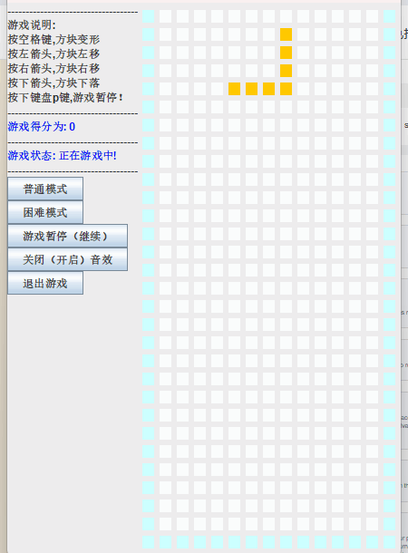
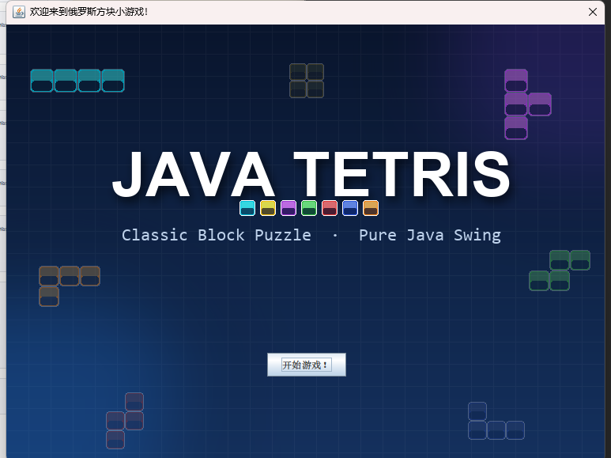
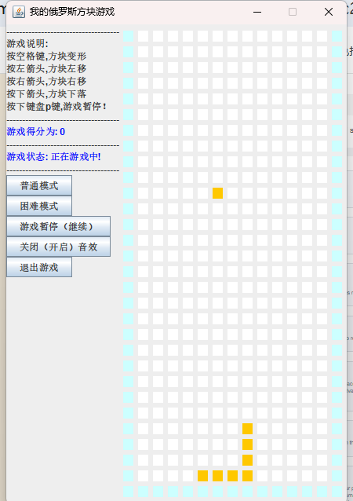
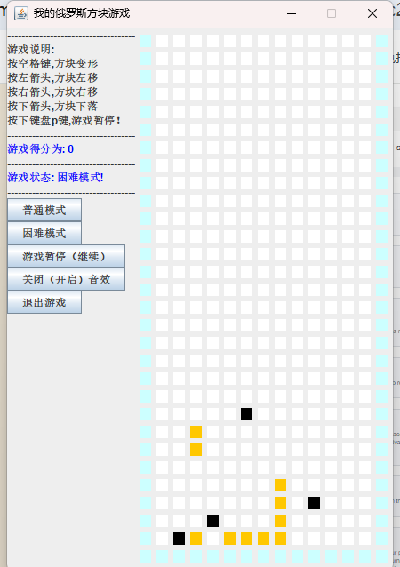
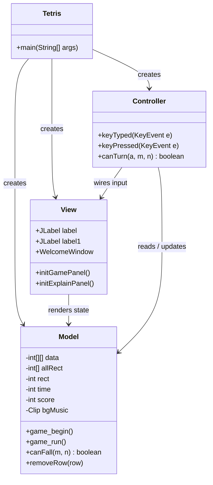
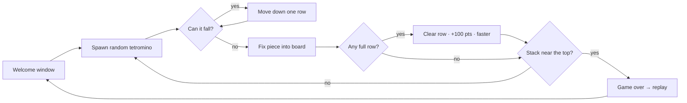

<div align="center">

# 🧱 Java Tetris

**A classic Tetris game built with pure Java Swing — MVC architecture, zero dependencies.**

[](https://github.com/alinj4253-droid/java-tetris-swing/actions/workflows/ci.yml)
[](LICENSE)




**English** | [简体中文](README_zh-CN.md)

</div>

---

## ✨ Features

- 🎮 **Classic Tetris gameplay** — 28 × 13 playable field, 7 tetromino shapes with rotation (22 encoded piece states)
- 🔥 **Two difficulty modes** — *Normal* slows the game down; *Hard* drops pieces faster and scatters 4 random obstacle blocks on the board
- ⏸️ **Pause / resume** with one key or button, plus music toggle and exit confirmation
- 🏆 **Scoring & speed ramp** — every cleared line is worth 100 points and makes the game 25 ms faster
- 🎵 **Looped background music** bundled and playable out of the box
- 🪶 **Zero dependencies** — only the JDK (Swing + AWT). No build tool required to compile and run

## 🎬 Demo

The GIF above is recorded from an actual game session (*Hard* mode: black obstacle cells are already on the board and pieces drop faster). Static previews:

| Welcome window | Gameplay | Hard mode |
| :---: | :---: | :---: |
|  |  |  |

<sub>If the GIF doesn't autoplay, the individual frames above show the same UI. All images live in [`docs/`](docs/).</sub>

## 🏗️ Architecture

The project follows the classic **MVC** pattern with plain Swing — no frameworks:



**Game loop:**



## 🚀 Quick Start

**Requirements:** JDK 17+ (verified by CI on 17 and 22). No build tools needed.

```bash
git clone https://github.com/alinj4253-droid/java-tetris-swing.git
cd java-tetris-swing

# compile (from the repo root, so the game can find its assets)
javac -encoding UTF-8 -d out src/*.java

# run — the working directory must be the repo root (music.wav / background.png are loaded relatively)
java -cp out Tetris
```

**IntelliJ IDEA:** open the repo folder as a project and run `src/Tetris.java` — the run configuration is created automatically.

> 💡 Chinese characters appear in the UI; on Linux/macOS make sure a CJK-capable font is installed.

## 🕹️ Controls

| Input | Action |
| --- | --- |
| `←` / `→` | Move piece left / right |
| `↓` | Soft drop |
| `Space` | Rotate piece |
| `P` | Pause / resume |
| 普通模式 / 困难模式 | Switch between Normal and Hard mode |
| 游戏暂停（继续） | Pause / resume button |
| 关闭（开启）音效 | Toggle background music |
| 退出游戏 | Exit with confirmation |

## 📁 Project Structure

```
java-tetris-swing/
├── src/
│   ├── Tetris.java        # entry point, wires MVC together
│   ├── Model.java         # game state: board, pieces, scoring, music
│   ├── View.java          # Swing UI: welcome window, board, side panel
│   └── Controller.java    # keyboard input, rotation, mode buttons
├── docs/                  # screenshots & demo GIF for the README
├── .github/workflows/     # CI: compile on JDK 17 / 22
├── background.png         # original welcome-screen artwork
├── music.wav              # looped background music
├── LICENSE
└── README.md
```

## 🧩 Implementation Notes

- **Piece encoding** — every shape/rotation state is a 16-bit bitmap (e.g. `0x00cc`); the board is a `int[30][15]` grid where `0` = empty, `1` = settled block / wall, `2` = hard-mode obstacle.
- **Collision & rotation** — bitmasks are scanned with a sliding `0x8000` mask; rotation validity is checked before applying a state change.
- **Timing** — the game thread sleeps `time` ms between drops (starts at 900 ms; Hard mode −300 ms; each cleared line −25 ms).
- **Audio** — BGM is played with `javax.sound.sampled.Clip` in a continuous loop and can be toggled at runtime.

## 🗺️ Roadmap

- [ ] Next-piece preview & ghost piece
- [ ] High-score persistence
- [ ] Replace `Thread.sleep` timing with `javax.swing.Timer`
- [ ] Unit tests for board / collision logic
- [ ] English UI (i18n)
- [ ] Package as a runnable fat JAR (`jpackage`)

Ideas and pull requests are welcome!

## 🤝 Contributing

1. Fork the repository and create your branch from `main`
2. Keep the MVC separation — game logic belongs in `Model`, rendering in `View`
3. Make sure `javac -encoding UTF-8 -d out src/*.java` passes (CI does the same)
4. Open a pull request with a clear description

## 📄 License

Released under the [MIT License](LICENSE). The project started as a university Java course-design assignment and is now maintained as a lightweight open-source game.

The welcome-screen artwork (`background.png`) is original artwork created for this project. The bundled background music is provided for personal / educational use — if you hold rights to it and would like it removed, please open an issue.
