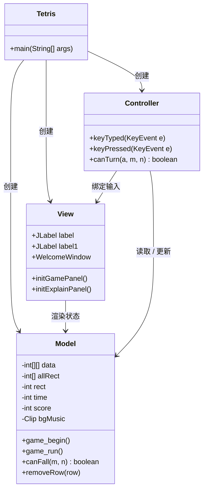
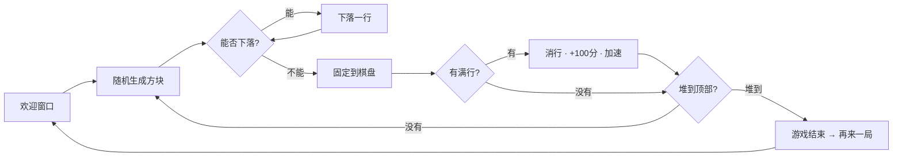

<div align="center">

# 🧱 Java Tetris（Java 俄罗斯方块）

**基于纯 Java Swing 实现的经典俄罗斯方块 — MVC 架构，零依赖。**

[](https://github.com/alinj4253-droid/java-tetris-swing/actions/workflows/ci.yml)
[](LICENSE)


[English](README.md) | **简体中文**

</div>

---

## ✨ 功能特性

- 🎮 **经典俄罗斯方块玩法** — 28 × 13 可玩区域，7 种四格方块，共 22 个形状/旋转状态（16 位位图编码）
- 🔥 **普通 / 困难双模式** — 普通模式降低下落速度；困难模式加速下落，并在棋盘上随机生成 4 个黑色障碍块
- ⏸️ **暂停 / 继续** — 按键或按钮均可，另有音效开关和退出确认
- 🏆 **消行计分与加速** — 每消除一行 +100 分，同时下落间隔缩短 25ms，越玩越快
- 🎵 **循环背景音乐** — 仓库内置，开箱即听
- 🪶 **零依赖** — 只需 JDK（Swing + AWT），无需任何构建工具即可编译运行

## 🎬 演示

上方 GIF 来自一次真实的游戏对局录制（困难模式：棋盘上已有黑色障碍块，下落速度更快）。静态预览：

| 欢迎界面 | 游戏进行中 | 困难模式 |
| :---: | :---: | :---: |
|  |  |  |

<sub>若 GIF 未能自动播放，可直接查看上方截图，素材均位于 [`docs/`](docs/) 目录。</sub>

## 🏗️ 系统架构

项目采用经典的 **MVC** 分层，纯 Swing 实现，不依赖任何框架：



**游戏主循环：**



## 🚀 快速开始

**环境要求：** JDK 17+（CI 已在 17 和 22 上验证编译）。无需构建工具。

```bash
git clone https://github.com/alinj4253-droid/java-tetris-swing.git
cd java-tetris-swing

# 编译（在仓库根目录执行，保证游戏能找到资源文件）
javac -encoding UTF-8 -d out src/*.java

# 运行 —— 必须在仓库根目录下启动（music.wav / background.png 按相对路径加载）
java -cp out Tetris
```

**IntelliJ IDEA：** 直接以项目方式打开仓库文件夹，运行 `src/Tetris.java` 即可，运行配置会自动生成。

## 🕹️ 操作说明

| 输入 | 功能 |
| --- | --- |
| `←` / `→` | 方块左移 / 右移 |
| `↓` | 加速下落 |
| `空格` | 方块变形 |
| `P` | 暂停 / 继续 |
| 普通模式 / 困难模式 | 切换难度 |
| 游戏暂停（继续） | 暂停 / 继续按钮 |
| 关闭（开启）音效 | 背景音乐开关 |
| 退出游戏 | 确认后退出 |

## 📁 项目结构

```
java-tetris-swing/
├── src/
│   ├── Tetris.java        # 入口，组装 MVC
│   ├── Model.java         # 游戏状态：棋盘、方块、计分、音乐
│   ├── View.java          # Swing 界面：欢迎窗口、棋盘、侧边栏
│   └── Controller.java    # 键盘输入、变形、模式按钮
├── docs/                  # README 使用的截图与演示 GIF
├── .github/workflows/     # CI：JDK 17 / 22 编译验证
├── background.png         # 原创欢迎界面背景图
├── music.wav              # 循环背景音乐
├── LICENSE
└── README.md
```

## 🧩 实现要点

- **方块编码** — 每个形状/旋转状态用 16 位位图表示（如 `0x00cc`）；棋盘为 `int[30][15]`：`0` 空、`1` 已固定方块/墙体、`2` 困难模式障碍。
- **碰撞与变形** — 用滑动掩码 `0x8000` 逐位扫描，变形前先检查目标位置是否合法。
- **计时** — 游戏线程每 `time` 毫秒下落一格（初始 900ms；困难模式 −300ms；每消一行 −25ms）。
- **音频** — 背景音乐通过 `javax.sound.sampled.Clip` 循环播放，可随时开关。

## 🗺️ Roadmap

- [ ] 下一方块预览 / 幽灵方块
- [ ] 最高分持久化
- [ ] 用 `javax.swing.Timer` 替换 `Thread.sleep` 计时
- [ ] 棋盘 / 碰撞逻辑单元测试
- [ ] 界面国际化（英文）
- [ ] 打包为可执行 fat JAR（`jpackage`）

欢迎提出想法和提交 PR！

## 🤝 参与贡献

1. Fork 本仓库，从 `main` 创建你的分支
2. 保持 MVC 分层 —— 游戏逻辑放 `Model`，界面渲染放 `View`
3. 确保 `javac -encoding UTF-8 -d out src/*.java` 通过（CI 会做同样的检查）
4. 提交 PR 并附清晰描述

## 📄 许可证

本项目基于 [MIT License](LICENSE) 开源。项目起源于大学《Java 程序课程设计》，现作为轻量级开源游戏维护。

欢迎界面背景图（`background.png`）为本项目原创绘制。内置背景音乐仅供个人 / 学习使用 —— 如果您持有该音频版权并希望移除，请提交 issue。
